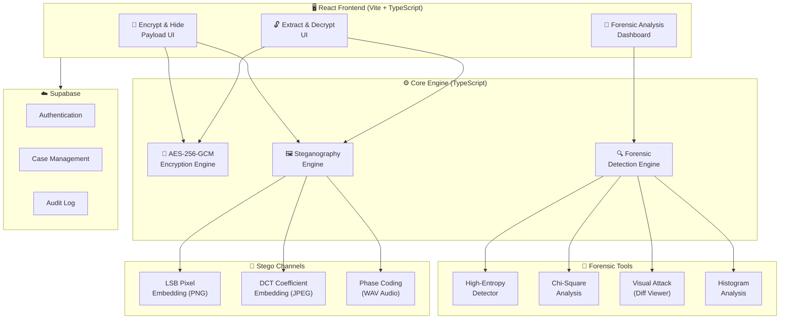
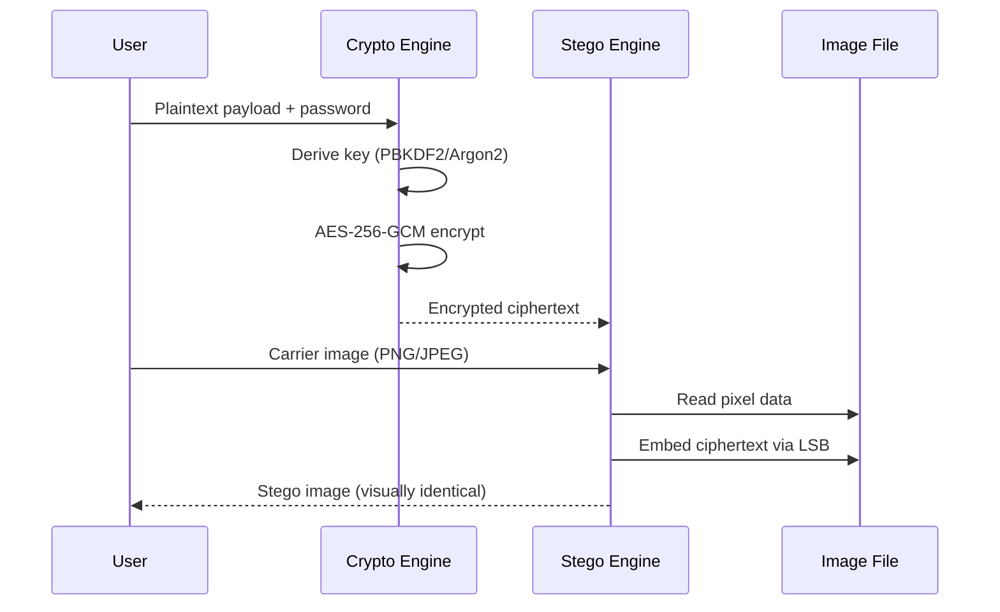

<div align="center">

# 🔐 HarryStegoСrypt

**Cyber Forensic & Cryptographic Steganography Suite**

[](https://github.com/harinish45/harry-stegocrypt/actions/workflows/ci.yml)
[](LICENSE)
[](https://typescriptlang.org)
[](https://vite.dev)

> *Next-gen browser-based steganography engine with AES-256 encryption, pixel-level payload embedding, and forensic detection tools*

[📋 TODO](TODO.md) · [📄 PRD](PRD.md) · [🔍 Live Demo](#)

</div>

---

## 🏗️ Architecture



---

## 🔐 Encryption + Embedding Flow



---

## 🚀 Quick Start

```bash
git clone https://github.com/harinish45/harry-stegocrypt.git
cd harry-stegocrypt
npm install
npm run dev    # → http://localhost:5173
```

---

## 📁 Structure

```
harry-stegocrypt/
├── 🖥️  src/
│   ├── components/    # React UI components
│   ├── lib/           # Core crypto + stego logic
│   ├── hooks/         # React hooks
│   └── pages/         # App routes
├── ☁️  supabase/      # DB migrations
└── 🌐  public/        # Static assets
```

---

<div align="center">
⚠️ For authorized digital forensics use only · <a href="LICENSE">MIT License</a>
</div>